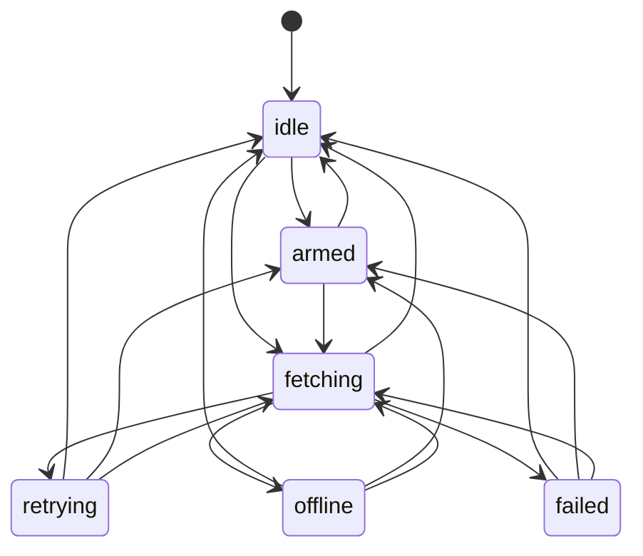
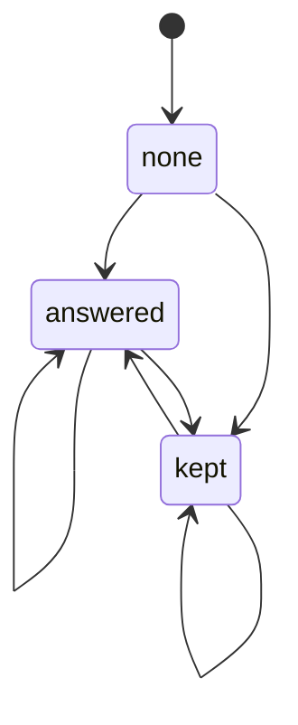

# How a hole flows

How a deferred region (a hole: `render: 'deferred'`, a server island) gets its HTML after the page,
as two machines held by each `<ogygia-region>` (`packages/core/src/runtime/region-machines.ts`,
driven from `core.ts`):

- `hole`: the region's **own fetch** of its answer;
- `hole-answer`: what is **on screen** from its answers.

They are two machines because they are independent: an answer can land while the hole waits to
retry, or come from somewhere other than its own fetch (a twin at the same address, a batch, a
preload, a write at its address). If you change how a hole moves, update this note in the same PR.
The diagrams below are drawn from the machines and checked by `packages/core/test/flow-docs.test.ts`.

## 1. Vocabulary

- **Hole**: a region whose server HTML is a fallback; its real HTML is fetched from the region
  endpoint (`endpoint` attribute, a signed address).
- **Answer**: HTML for the hole. **Kept**: the server answered `keepFallback()`: the fallback is the
  right answer for this visitor.
- **Address**: the hole's endpoint URL. Holes at one address are **twins**; one fetch answers them
  all (a flight per address).
- **Refused**: an answer that may not enter the page (redirected, a whole document): the fallback
  stands and nothing retries.
- **Schedule** (`when`, `prefetch`): when the hole fetches; its listeners belong to `armed`.

## 2. The guiding rule

> A hole shows its fallback until an answer for it lands, and only an answer for it. Its own fetch
> retrying, failing or being called off never takes away an answer already on screen.

So:

- an answer that lands from anywhere ends the hole's own waiting (a retry it waited for is called
  off), and the answer stands;
- a failed fetch only retries while nothing is on screen; with an answer up, it goes back to rest;
- a hole that leaves the page drops its schedules, its retry, and its place in a shared fetch; the
  answer stays with the element, so a region put back keeps what it showed.

## 3. The fetch

<!-- graph:hole -->



<!-- /graph -->

- **idle**: not asked yet, or its fetch ended.
- **armed** `{attempts}`: its schedule is set.
- **fetching** `{attempts, revalidate}`: its fetch is a task of this visit (`hole.scope.task`).
- **retrying** `{attempts, revalidate}`: a fetch failed; it waits (`backoffAfter`) to try again.
- **failed**: refused, or out of tries. The fallback (or the answer before) stands.

## 4. What is on screen

<!-- graph:hole-answer -->



<!-- /graph -->

- **none**: the fallback.
- **answered**: an answer is swapped in. Each later answer is a move of its own
  (`answered → answered`), so `trace()` and devtools see every one.
- **kept**: it answered `keepFallback()`; the fallback stands as its answer (`kept → kept` when it
  says so again).

Which answer is newer is the frame store's call, not the hole's: a decoded command answer is ordered
by its data version first, then by request ticket (`internal/notes/frames.md`).

Where each move is made (`core.ts`):

| Move                                      | Where             | Why                                                                                         |
| ----------------------------------------- | ----------------- | ------------------------------------------------------------------------------------------- |
| `idle`/`retrying`/`failed → armed`        | `#hole_armed()`   | a schedule is set (not while a fetch is in flight)                                          |
| → `fetching`                              | `#fetch_html()`   | the schedule fired, or a refresh                                                            |
| `fetching → idle`                         | `#fetch_html()`   | its answer came back to this visit                                                          |
| `fetching → idle`                         | `#bind()`         | a refresh re-minted it at a new address: the fetch out at the old one is left               |
| `fetching → retrying` / `idle` / `failed` | `#fetch_failed()` | a try failed: retry while nothing is on screen; rest if an answer is up; give up when final |
| `armed`/`retrying`/`failed → idle`        | `#answered()`     | an answer landed from anywhere                                                              |
| `hole-answer` → `answered` / `kept`       | `#answered()`     | every answer that lands is a move, the same kind again included                             |
| any → `idle`                              | teardown          | the region left the page                                                                    |

## 5. Scenarios

### 5.1 A twin answers while the hole waits to retry

Test: `packages/core/test/browser/hole-lifecycle.test.ts` › `a hole its twin answers while it waits
to retry still wakes its island`.

1. The hole's fetch fails: `fetching → retrying`, a backoff timer is set in the visit.
2. Its twin's fetch answers the address: `hole-answer none → answered`, and `#answered()` moves
   `retrying → idle`. Leaving `retrying` clears the timer: no second fetch.
3. The answer's island is armed and wakes (the region-wake note).

### 5.2 A kept fallback, then a real answer

Test: `packages/core/test/browser/hole-lifecycle.test.ts` › `a kept fallback that later gets a real
answer is not kept any more, and its island wakes`.

1. The server says `keepFallback()`: `none → kept`.
2. A later answer (a refresh): `kept → answered`; the island in it wakes.

### 5.3 A refetch that fails

Test: `packages/core/test/browser/hole-lifecycle.test.ts` › `a refetch that failed does not mark the
hole’s first answer a refresh`.

1. `answered` is on screen; a refetch starts (`fetching`) and fails.
2. With an answer up, `fetching → idle`: no retry loop, and the answer on screen is untouched.

### 5.4 A refused answer

Tests: `packages/core/test/browser/deferred-endpoint.test.ts` › `a hole answer that was REDIRECTED is
refused: the fallback stands, no retry`; `packages/core/test/browser/early-holes.test.ts` › `a refused
answer stays at its address: the hole that wakes later is refused too, and asks nothing`.

1. `fetching`; the answer is refused.
2. `fetching → failed`; `hole-answer` stays `none`. A twin that asks later gets the same refusal
   from the address without a fetch.

### 5.5 Twins and leaving

Test: `packages/core/test/browser/hole-twins.test.ts` › `a copy that leaves does not cancel its twin’s
retry`.

1. Two holes at one address share one fetch; it fails, both `retrying`.
2. One leaves the page: its teardown moves it to `idle` and takes it out of the shared fetch. The
   other's retry goes on.

### 5.6 Schedules leave with the state

Tests: `packages/core/test/browser/hole-lifecycle.test.ts` › `a hole that arms two media schedules
disarms both when it leaves`, and `a hole whose prefetch and island both wait to be visible stops
watching for both when it leaves`.

1. `armed`: two schedules' listeners are set in the visit.
2. The region leaves: `armed → idle`; closing the visit drops every listener.

### 5.7 A failure that lands as it leaves

Test: `packages/core/test/browser/hole-lifecycle.test.ts` › `a hole whose failed fetch lands as it
leaves the page settles quietly, whatever the timing`.

1. `fetching`; the region leaves (`→ idle`) as the fetch fails.
2. The failure finds the visit gone and does nothing: no retry, no message.

### 5.8 A refresh re-mints a hole while its first fetch is out

Test: `packages/core/test/browser/hole-lifecycle.test.ts` › `a refresh that re-mints a hole while its
first fetch is out shows the new address’s answer, not the old one`.

1. `fetching` at the first address; a live tick re-mints the hole at a new one.
2. `#bind()` moves to the new address and `fetching → idle`: the old fetch is left, and the hole
   asks the new address.
3. The new answer paints. The old one, landing later, is for a call this hole no longer is: it never
   paints.

### 5.9 A hole answered twice

Test: `packages/core/test/browser/hole-lifecycle.test.ts` › `a hole answered twice moves once per
answer, and the second answer is the one on screen`.

1. The first answer: `none → answered`.
2. A refresh answers again: `answered → answered`, and the second answer is the one on screen.

## 6. Rough edges

None open.

## 7. Tracing it

Scenario 5.1 in a trace (`@ogygia/machine` `trace()`), in outline (the numbers are the order each
machine first moved, and wake lines are left out):

```
hole#1 idle -> fetching
hole#2 idle -> fetching
hole#1 fetching -> retrying
hole-answer#2 none -> answered
hole#2 fetching -> idle
hole-answer#1 none -> answered
hole#1 retrying -> idle
```
