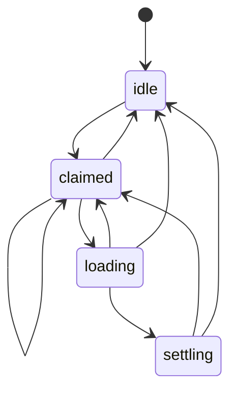

# How a navigation flows

How the SPA router takes a click to a new page on screen, as one machine: `navigation`
(`packages/core/src/runtime/navigation.ts`). The router (`router.ts`) and the navigation chunk
(`router-nav.ts`) both read and move it. If you change how a navigation moves, update this note in
the same PR. The diagram below is drawn from the machine itself and checked by
`packages/core/test/flow-docs.test.ts`.

- [1. Vocabulary](#1-vocabulary)
- [2. The guiding rule](#2-the-guiding-rule)
- [3. The states](#3-the-states)
- [4. Scenarios](#4-scenarios)
- [5. Rough edges](#5-rough-edges)
- [6. Tracing it](#6-tracing-it)

## 1. Vocabulary

- **Navigation**: one click (or `goto`, or a back/forward step) that the router turns into a new
  page without a full load.
- **Visit**: one stay in a state of the machine. Each `go('claimed', …)` is a new visit, with its own
  state object and its own scope (`nav.scope`): leaving the state closes the scope, which aborts the
  visit's fetch and drops what it held.
- **Claim**: the router taking a click as its own, before the navigation chunk has loaded.
- **Swap**: the new page's body and head going in. Only the visit that fetched the page may swap it.
- **Hand-off**: giving the navigation to the browser (`router.hand_off`): a page the router will not
  render, one it could not fetch, a swap that failed. The visit ends there.
- **Supersede**: back (or a link) to the page already on screen while another page loads: the load
  in flight is dropped (`router.supersede`).

## 2. The guiding rule

> The newest navigation wins, and only it may change the screen. A page the visitor no longer asked
> for never lands.

So:

- a second click while the first is still claimed or loading starts a new visit; the first visit's
  fetch is aborted and its answer, if it comes, is not applied;
- a navigation that leaves the router (a hand-off) ends its visit, so nothing waits on it;
- once a page is in, its navigation is `settling`, so a click on the same address is a refresh, not a
  second copy of the same navigation.

## 3. The states

<!-- graph:navigation -->



<!-- /graph -->

- **idle**: nothing in flight.
- **claimed** `{href}`: the router took the click; the navigation chunk loads. A web-component link
  that re-dispatches the same click sees the claim and joins it instead of starting another.
- **loading** `{href}`: the page is fetched and, if it is still this visit's, swapped in. The fetch is
  a task of the visit.
- **settling** `{href}`: the page is in; scroll, focus, the announcement and the after hooks run.

Where each move is made:

| Move                                              | Where                                           | Why                                                                    |
| ------------------------------------------------- | ----------------------------------------------- | ---------------------------------------------------------------------- |
| `idle`/`claimed`/`loading`/`settling` → `claimed` | `router.ts` `navigate()`                        | a click (after any `beforeNavigate` guard let it through): newest wins |
| `claimed` → `loading`                             | `router-nav.ts` `navigate()`                    | the chunk loaded; the page's fetch starts                              |
| `loading` → `settling`                            | `router-nav.ts` (`move('loading', 'settling')`) | the swap went in                                                       |
| `settling` → `idle`                               | `router-nav.ts`, end of `navigate()`            | the page is done, unless a newer click took over                       |
| any → `idle`                                      | `router.ts` `hand_off()`                        | the browser takes it from here                                         |
| any → `idle`                                      | `router.ts` `supersede()`                       | back to the page on screen: the load in flight never lands             |

## 4. Scenarios

Each scenario names the test that drives it.

### 4.1 One click, one page

Test: `apps/palaestra/e2e/router-race.spec.ts` › `last navigation wins: URL settles on /data and the
DOM matches it` (its last click, alone).

1. The click passes the guards: `idle → claimed {href}`.
2. The chunk is there: `claimed → loading`, the fetch is a task of this visit.
3. The page arrives and is still this visit's: swap, `loading → settling`.
4. Scroll, focus, after hooks, `og:page-load`: `settling → idle`. The visit's scope closes and lets go
   of the fetch's controller.

### 4.2 Two clicks while the chunk downloads

Test: `apps/palaestra/e2e/router-ownership.spec.ts` › `#203 two clicks while the router chunk
downloads: the last one wins`.

1. Click A: `idle → claimed {A}`; the chunk starts loading.
2. Click B: `claimed {A} → claimed {B}`, a new visit.
3. The chunk arrives. A's `navigate()` sees the machine is no longer its visit and returns. B goes on
   to `loading`, `settling`, `idle`. Page A never shows.

### 4.3 Two clicks while the first page loads

Test: `apps/palaestra/e2e/router-race.spec.ts` › `last navigation wins: URL settles on /data and the
DOM matches it`. Seeded: `packages/core/test/browser/sim-router.test.ts` (newest navigation wins).

1. Click A reaches `loading {A}`; its fetch is out.
2. Click B: `loading {A} → claimed {B}`. Leaving A's visit closes its scope: A's fetch is aborted, and
   an answer already read is `STALE`.
3. B runs to `idle`. The screen goes from the old page straight to B.

### 4.4 Back while the next page loads

Test: `apps/palaestra/e2e/router-race.spec.ts` › `back while the next page loads: the load never
lands, Back goes back from the page on screen`.

1. A click reaches `loading {next}`.
2. Back to the page on screen: `supersede()`, `loading → idle`. The fetch is aborted.
3. The next page never swaps in under the old page's address.

### 4.5 A link the browser keeps the page for

Test: `apps/palaestra/e2e/router-document-fetch.spec.ts` › `a link the browser never replaces the page
for works every time (#266, #297)`.

1. The click claims and loads; the answer is not a page the router renders (a download, a 204).
2. `hand_off()`: `loading → idle`, then the browser navigates. The page stays on screen.
3. A second click on the same link starts a new navigation. (Before #266 the visit stayed `loading`
   and every later click joined it and was swallowed.)

### 4.6 A swap that fails

Test: `packages/core/test/browser/nav-swap-fails.test.ts` › `a swap that throws …: the navigation
ends and goes to the browser`.

1. `loading`, the swap throws.
2. `hand_off()` with the error: it is reported, `loading → idle`, and the browser loads the page whole.

### 4.7 A guard that cancels

Test: `apps/palaestra/e2e/router-ownership.spec.ts` › `a click a beforeNavigate guard cancels never
ends the navigation already in flight`.

1. A navigation is `loading`.
2. A click whose `beforeNavigate` cancels never claims, so it does not take over: the navigation in
   flight finishes as if the click never happened.

## 5. Rough edges

Each is a filed issue.

- **The claim's wait for the chunk is a plain await with a hand check** (#673). `navigate()` awaits
  the navigation chunk, then checks `this.nav.now !== mine` by hand. As a task of the claim's visit
  it would answer `STALE` on its own once a newer click takes over.

## 6. Tracing it

With rules on (dev, an `OGYGIA_RULES=1` build), a failing e2e test attaches the page's machine moves
(`@ogygia/machine` `trace()`). Scenario 4.3 reads like this:

```
navigation#1 idle -> claimed
navigation#1 claimed -> loading
navigation#1 loading -> claimed
navigation#1 claimed -> loading
navigation#1 loading -> settling
navigation#1 settling -> idle
```

The router keeps one navigation machine, so every visit is `navigation#1`; a new visit shows as a
move into `claimed`.
