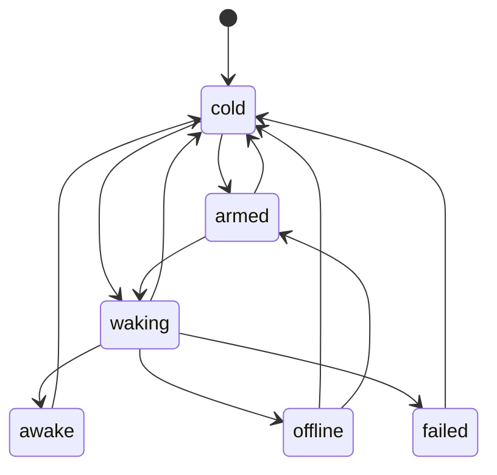

# How a region wakes

How an island region goes from server HTML to a live component, as one machine: `wake`
(`packages/core/src/runtime/region-machines.ts`), held by each `<ogygia-region>` element
(`packages/core/src/runtime/core.ts`). If you change how a wake moves, update this note in the same
PR. The diagram below is drawn from the machine itself and checked by
`packages/core/test/flow-docs.test.ts`.

The other region machines (the hole's fetch, its answer, live ticks, painting) run beside this one;
holes have their own note.

## 1. Vocabulary

- **Island**: a region with client code. Its server HTML is on the page before any JavaScript runs.
- **Schedule** (`wake` attribute): when the island wakes: `load`, `idle`, `visible`, `media`,
  `interaction`. Arming a schedule sets its listeners.
- **Capture**: while an island is asleep, clicks and typing inside it are caught, held, and replayed
  once it is live (`interaction.ts`).
- **Turn**: the scheduler gives one island at a time a task to hydrate in, viewport first
  (`schedule.ts`). Each region's waits go through its mailbox (`turn.wait`).
- **Visit**: one stay in a state. Leaving a state closes its scope, which drops everything armed in
  it.
- **Teardown**: the region leaves the page (removed, or moved and put back).

## 2. The guiding rule

> An island wakes once, on its schedule or a visitor's first touch, and nothing the visitor did
> before it was live is lost. A region that left the page wakes nothing.

So:

- every schedule's listeners belong to `armed`; leaving `armed` (the wake fired, or the region left)
  drops all of them, so two schedules can never both fire;
- the capture holds input from `armed` through `waking`; once `awake` (or `failed`) the island's own
  handlers take over, and held input is replayed (onto the server markup, if it failed);
- every wait inside `waking` checks it is still this visit and the region is still on the page.

## 3. The states

<!-- graph:wake -->



<!-- /graph -->

- **cold**: asleep, nothing armed.
- **armed**: its schedule (and the capture) is set.
- **waking**: its module and the hydrate core load, then it waits for its turn and hydrates.
- **awake**: hydrated; the island is live.
- **failed** `{error}`: hydrating threw. The server markup stays as it is.

Where each move is made (all in `core.ts`):

| Move                                 | Where                                     | Why                                                                            |
| ------------------------------------ | ----------------------------------------- | ------------------------------------------------------------------------------ |
| `cold → armed`                       | `connectedCallback` path, `#arm_phase2()` | the region is on the page with a schedule; or a deferred island's answer is in |
| `cold`/`armed → waking`              | `#hydrate()`                              | the schedule fired, or a visitor touched it first                              |
| `waking → awake` / `failed` / `cold` | `#hydrate()` `finally`                    | hydrated; threw; or nothing was mounted (not this region's to wake)            |
| any → `cold`                         | teardown                                  | the region left the page: its schedules and capture go with the visit          |

## 4. Scenarios

### 4.1 A scheduled island wakes

Test: `packages/core/test/browser/interaction-delegated.test.ts` › `a SCHEDULED island is armed the
same way: a click before it is live is canceled and queued`.

1. The region connects: `cold → armed`; its schedule and the capture are set.
2. The schedule fires: `armed → waking`. Leaving `armed` drops the schedule's listeners; the capture
   is handed on to `waking`.
3. Module and core load; the turn comes; the hydrate runs: `waking → awake`. The capture is disarmed
   and any held click is replayed.

### 4.2 Clicks and typing before the code is live

Test: `apps/palaestra/e2e/load-early-click.spec.ts` › `two clicks before its code is live both count
once it is live`, and `text typed before its code is live stays, bound, and focus stays in the
field`.

1. `armed` or `waking`: the visitor clicks twice and types. The capture cancels and queues the
   clicks; typed text stays in the server markup's field.
2. `waking → awake`: the island hydrates over the field (its value kept, focus kept) and the queued
   clicks are replayed, each counted once.

### 4.3 One region, one wake

Test: `packages/core/test/browser/interaction-delegated.test.ts` › `an event inside an armed region
wakes THAT region only, once; the pointer warms once`.

1. Several regions are `armed`. A click lands inside one.
2. Only that region goes `armed → waking`; a second event while it is `waking` does not start a
   second wake (`#hydrate` returns unless it is `cold` or `armed`).

### 4.4 A wake that fails

Test: `packages/core/test/browser/hole-lifecycle.test.ts` › `an interaction island that fails to wake
says so, and its click is replayed on the server markup`.

1. A click: `armed → waking`.
2. Hydrating throws: `waking → failed {error}`. The error is said with its code.
3. The capture's promise rejects, so the held click is replayed onto the server markup, which still
   works as plain HTML.

### 4.5 Taken out while it loads, put back

Test: `packages/core/test/browser/hole-lifecycle.test.ts` › `a region taken out while its island
loads and put back wakes once, and stops catching clicks once awake`.

1. `waking`: its module is loading.
2. The region is removed: teardown, `waking → cold`. The visit's scope closes; the load's answer, when
   it comes, finds the visit gone (`gone()`) and mounts nothing.
3. The region is put back: `cold → armed → waking → awake`, once.

### 4.6 A capture armed again while the first wake loads

Test: `packages/core/test/browser/interaction-rearm.test.ts` › `a capture armed again while the first
one’s wake loads catches the next click, and the first leaves it alone`.

1. A wake is `waking`; the region is armed again (a newer visit).
2. The next click is caught by the new capture; the first wake, finishing, does not disarm it.

## 5. Rough edges

Each is a filed issue.

- **The waits in `waking` check their visit by hand** (#675). Each `turn.wait(…)` is followed by
  `gone()`, which compares `this.#wake.now !== mine`. A wait that ended with the waking visit would
  make a missing check impossible.

## 6. Tracing it

A failing test prints the machine moves (`@ogygia/machine` `trace()`). Scenario 4.5 reads like this:

```
wake#1 cold -> armed
wake#1 armed -> waking
wake#1 waking -> cold
wake#1 cold -> armed
wake#1 armed -> waking
wake#1 waking -> awake
```
